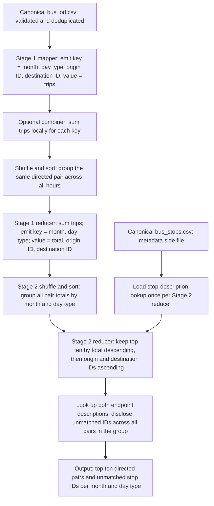
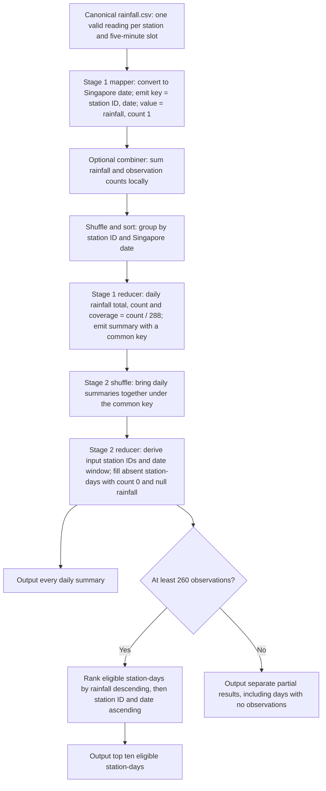
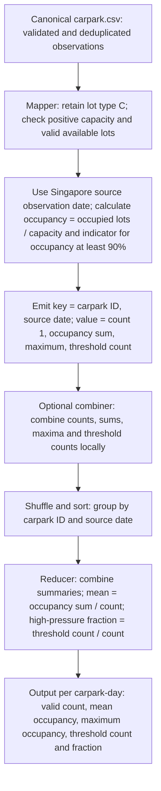
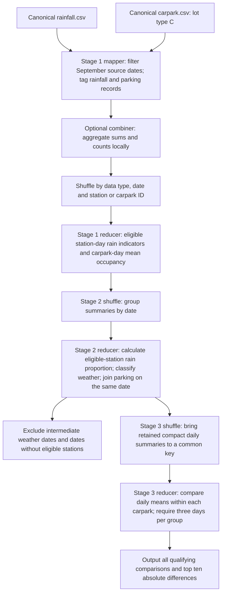

# MapReduce Analytics

## M1 Busiest Directed Bus Corridors

### Method
The job reads the prepared canonical bus OD data. Stage 1 sums
TOTAL_TRIPS across hours for each month, day type and directed
origin–destination pair. Stage 2 selects the top ten pairs,
breaking ties by origin and destination IDs, and attaches both
stop descriptions.

### MapReduce Logic Diagram



The two reducer stages require different grouping keys. No custom mapper is
needed in Stage 2; Stage 1 output is forwarded for regrouping.

### Validation and Execution
The ten-record canonical sample matched the expected rankings
and preserved stop-ID leading zeroes. The full dataset was then
processed on YARN, with both stages reporting SUCCEEDED.

### Findings
For September 2026, the highest-volume directed pair in both
day-type groups was 46101 (W'lands Checkpt) to 46211
(Johor Bahru Checkpt).

| Day type | Total trips |
|---|---:|
| WEEKDAY | 516,385 |
| WEEKENDS/HOLIDAY | 194,090 |

Checkpoint-related pairs also occupied the second and third
positions in both rankings. This highlights these corridors
as candidates for further operational capacity review.

These are monthly totals aggregated within each day type.
Direction is preserved, and the results describe stop pairs.

### Data Limitations
Preparation retained 7,995 OD rows containing stop IDs absent
from the metadata. The final output discloses three unmatched
IDs in the weekday group and five in the weekend/holiday group.

Only September 2026 was analysed. Complete repeated-run timing
will be documented in the performance analysis.


## M2 Rainfall by Station and Day

### Method
The job reads the prepared canonical rainfall data. Stage 1 sums observed
rainfall and counts valid unique five-minute observations per station and
Singapore calendar date. Daily coverage is the observation count divided
by 288. Stage 2 ranks the top ten station-days with at least 260
observations, meeting the 90% coverage threshold. Rainfall is ranked
descending, with station ID and date used to break ties.

The output retains all daily summaries and a separate partial-results
category. Completely absent station-days within the reporting scope
have zero observations, zero coverage and null rainfall.

### MapReduce Logic Diagram



The second stage compares daily summaries for ranking and reports gaps within
the input-derived station and calendar scope. No custom mapper is needed there.

### Validation and Execution
A controlled sample used 807 actual readings from 22 September 2026.
S306 retained 288 observations, S904 retained 260 and S06 retained 259.
The deliberate omissions applied only to the sample.

The sample output matched the expected results. S306 ranked first with
130.6 mm and 100% coverage, and S904 ranked second with 123.2 mm and
90.28% coverage. S06 recorded 47.4 mm and 89.93% coverage and was retained
separately as a partial day. This checked the eligibility boundary.

The full canonical dataset contained 761,445 observations. Both YARN
stages completed successfully:

| Stage | Application ID | Final status |
|---|---|---|
| Daily aggregation | application_1795002805512_0004 | SUCCEEDED |
| Ranking and partial results | application_1795002805512_0005 | SUCCEEDED |

The first complete run took 55.78 seconds, including job submission and
output retrieval, with exit code 0. Further repeated runs are required
for the performance analysis.

The [results](../../evidence/m2-output.txt),
[execution logs](../../evidence/m2-yarn-log.txt) and
[timing](../../evidence/m2-run1-timing.txt) are saved under evidence/.

### Findings
The highest observed rainfall among eligible station-days was 130.6 mm
at S306, Murnane Service Reservoir, on 22 September 2026.

| Rank | Station | Date | Observed rainfall | Coverage |
|---|---|---|---:|---:|
| 1 | S306 Murnane Service Reservoir | 2026-09-22 | 130.6 mm | 100% |
| 2 | S904 Holland Grove Road | 2026-09-22 | 123.2 mm | 100% |
| 3 | S904 Holland Grove Road | 2026-09-27 | 121.0 mm | 100% |

Of 2,670 reported station-days, 2,631 met the coverage threshold.
The separate partial category contained 23 partially observed days and
16 days without readings. Rainfall values describe individual
station-days; readings from different stations are kept separate.

### Data Limitations
The reporting scope uses the station IDs present in the input and the
calendar window between its earliest and latest observations. Station
operating dates were unavailable, so a day without readings indicates
missing data within this reporting scope.

Daily totals sum available readings. Missing intervals remain missing,
and incomplete observations can underestimate rainfall even when a day
meets the 90% eligibility threshold.

The downloaded CSV lacks source-update and retrieval timestamps.
Those canonical fields are blank, and this limitation is recorded in
the rainfall preparation profile. Only September 2026 was analysed.

## M3 Daily Parking Pressure

### Method
The job reads canonical carpark observations and retains lot type C.
For each observation, occupancy is (total_lots - lots_available) /
total_lots. Capacity must be positive, and available lots must be between
zero and capacity. Preparation removes duplicate observations before analysis.

One MapReduce stage groups observations by carpark ID and source
observation date in Singapore time. A combiner aggregates intermediate
counts, occupancy sums, maxima and counts at or above 90% occupancy.
The reducer reports the valid observation count, mean occupancy ratio,
maximum occupancy ratio and fraction of observations at or above 90%.
Each observation uses its own capacity and receives equal weight in the mean.
Ratios are reported to six decimal places.

### MapReduce Logic Diagram



Only one stage is required because all statistics use the same carpark-day
key. The combiner preserves sums and counts rather than averaging averages.

### Validation and Execution
The sample contained the header and first ten canonical observations.
The inline output matched calculations from these source records:

| Carpark | Source date | Valid observations | Mean occupancy ratio | Maximum occupancy ratio | Fraction at least 90% |
|---|---|---:|---:|---:|---:|
| A10 | 2026-08-31 | 1 | 0.625000 | 0.625000 | 0.000000 |
| A10 | 2026-09-01 | 9 | 0.592014 | 0.656250 | 0.000000 |

This checked aggregation and source-date grouping. The sample did not
contain readings reaching the 90% threshold, other lot types or changing
capacities, so it did not independently exercise those cases.

The full canonical dataset was processed using the Hadoop runner:

| Stage | Application ID | Final status |
|---|---|---|
| Daily parking aggregation | application_1795002805512_0006 | SUCCEEDED |

The [sample results](../../evidence/m3-sample-output.txt),
[sample log](../../evidence/m3-sample-log.txt),
[full results](../../evidence/m3-output.txt),
[execution log](../../evidence/m3-yarn-log.txt) and
[YARN application screenshot](../../evidence/m3-yarn-applications.png)
are saved under evidence/.

### Findings
For carpark A10 on 3 September 2026, the full output recorded:

| Measure | Result |
|---|---:|
| Valid observations | 24 |
| Mean occupancy | 60.42% |
| Maximum occupancy | 100% |
| Observations at or above 90% occupancy | 3 |
| Fraction of observations at or above 90% occupancy | 12.5% |

This example shows that a moderate daily average can conceal periods of
high parking pressure. Operators could use both the mean and the high-pressure
fraction to identify carpark-days for closer review. This is an illustrative
carpark-day, not a claim that A10 was the busiest carpark in the dataset.

### Data Limitations
Statistics are sample-weighted rather than time-weighted. Sampling intervals
may vary, so 12.5% of observations does not necessarily mean 12.5% of the day.
Days with few observations provide limited evidence of daily conditions.

Grouping uses observed_at, the source carpark update timestamp, rather than
the API response date or the filename. Some source observations predate
September 2026 and remain assigned to their actual source dates.

The downloaded data lacks retrieval timestamps, so retrieved_at is blank.
Occupancy snapshots do not measure vehicle arrivals, turnover or parking duration.


## M4 Parking Occupancy and Regional Rainfall Context

### Self-Generated Question
Which carparks show the largest differences in mean observed daily occupancy
between widespread-rainfall days and days with no recorded rainfall among
eligible stations during September 2026?

### Business Justification
Parking operators can use this analysis to identify carparks whose observed
occupancy differs between regional weather conditions and prioritise locations
for further operational review. The analysis compares mean daily occupancy
within each carpark, reporting supporting day and observation counts. It provides
exploratory evidence for reviewing wet-weather parking guidance and capacity
management. Regional rainfall does not establish rainfall at individual carparks,
and differences may also reflect weekday patterns, events and uneven sampling.

### Method and Analysis Rules
Both inputs are frozen, validated and deduplicated canonical CSVs. No additional
location data or spatial assignments are used. This is a date-based contextual
comparison, not a carpark-to-weather-station spatial join.

| Rule | Definition |
|---|---|
| Period | Source observations dated September 2026 in Asia/Singapore |
| Eligible station-day | At least 260 of 288 unique five-minute rainfall slots |
| Daily weather measure | Stations with rainfall above zero divided by eligible stations; rainfall depths are not summed across stations |
| Widespread rainfall | At least 50% of eligible stations recorded rainfall above zero |
| No recorded rainfall | No eligible station recorded rainfall above zero |
| Excluded dates | Intermediate proportions, or no eligible rainfall stations |
| Parking input | Valid unique observations of lot type C, using each observation's own capacity |
| Daily occupancy | Mean observation occupancy for each carpark and source date |
| Weather-group mean | Mean of contributing daily occupancy means; each day has equal weight |
| Minimum support | At least three contributing carpark-days in each weather group |
| Signed difference | (Widespread-rainfall mean minus no-recorded-rainfall mean) multiplied by 100, in percentage points |
| Ranking | Top ten by absolute unrounded difference descending, then carpark ID ascending |

The 50% weather threshold and three-day minimum are declared analysis choices.
The minimum is a support filter, not a statistical significance test. The output
contains a comparison record for every qualifying carpark and a separate top-ten
ranking. Negative differences mean lower observed occupancy on widespread-rainfall
days; positive differences mean higher observed occupancy on those days.

### MapReduce Logic Diagram



Stage 3 accumulates per-carpark sums, day counts and observation counts rather
than storing raw observations. This uses one final reducer for global ranking
and is intended for the supplied classroom dataset scale.

### Sample Design and Expected Results
The sample-creation command selects actual canonical records from 3, 4, 5, 21,
22 and 27 September 2026. It creates only two input CSVs:

- m4_sample_rainfall.csv: 1,727 S306 observations across those six dates.
- m4_sample_carpark.csv: 262 lot-type-C observations for A10 and A11.

A11's 27 September observations are deliberately omitted from the sample to test
the three-day minimum. The full canonical inputs are unchanged. In this controlled
one-station sample, three dates have recorded rainfall and three have none. These
sample classifications do not represent the full network's weather categories.

Independent calculations from the selected records give:

| Sample result for A10 | Expected value |
|---|---:|
| Widespread-rainfall days | 3 |
| No-recorded-rainfall days | 3 |
| Parking observations in each group | 72 |
| Widespread-rainfall mean occupancy ratio | 0.481554 |
| No-recorded-rainfall mean occupancy ratio | 0.544271 |
| Signed difference, percentage points | -6.271701 |
| Absolute difference, percentage points | 6.271701 |

A10 should be the only qualifying comparison and rank first. A11 should be
excluded because it has only two rainfall days in the sample. The one-station
sample does not exercise the mixed-station 50% boundary. Its rainfall slots are
all above the eligibility minimum, so it does not exercise the 259/260 boundary.

### Validation and Execution
The script's calculation functions were checked against independent rational-number
calculations on the selected records. Additional function-level checks exercised
the 259/260 coverage boundary, exactly 50% wet stations and missing weather.

The inline sample run completed all three stages. Its output matched the expected
A10 means and signed difference. The counters reported three dates per weather
group and one carpark below the minimum supporting-day requirement (A11).

The full Hadoop run completed all three YARN applications successfully:

| Stage | Application ID | Final status |
|---|---|---|
| Daily rainfall and parking aggregation | application_1795002805512_0007 | SUCCEEDED |
| Weather classification and date join | application_1795002805512_0008 | SUCCEEDED |
| Carpark comparisons and ranking | application_1795002805512_0009 | SUCCEEDED |

Sample creation:

```sh
docker compose exec -T client python3 mapreduce/m4_rainfall_parking.py --create-sample
```

Inline validation (Windows Command Prompt):

```cmd
docker compose exec -T client python3 mapreduce/m4_rainfall_parking.py -r inline mapreduce/m4_sample_rainfall.csv mapreduce/m4_sample_carpark.csv > evidence\m4-sample-output.txt 2> evidence\m4-sample-log.txt
```

Full YARN execution (Windows Command Prompt):

```cmd
docker compose exec -T client python3 mapreduce/m4_rainfall_parking.py -r hadoop hdfs:///sg_mobility/canonical/rainfall.csv hdfs:///sg_mobility/canonical/carpark.csv > evidence\m4-output.txt 2> evidence\m4-yarn-log.txt
```

Independent reference calculations using exact rational arithmetic for canonical
parking observations and the checked M2 station-day rainfall summaries matched
all qualifying carpark IDs, supporting counts, six-decimal means and differences.
The top-ten order also matched when ranked by unrounded absolute differences.
Signed zero in the saved decimal output is numerically equivalent to zero.

The [sample output](../../evidence/m4-sample-output.txt),
[sample log](../../evidence/m4-sample-log.txt),
[full results](../../evidence/m4-output.txt),
[YARN execution log](../../evidence/m4-yarn-log.txt) and
[application screenshot](../../evidence/m4--yarn-applications.png)
are saved under evidence/.

### Findings
September contained nine widespread-rainfall dates, twelve dates with no recorded
rainfall among eligible stations, and nine intermediate dates excluded from this
comparison. There were 1,996 qualifying carparks; another four carparks represented
on the retained weather dates failed the minimum of three days per group.
The first-stage counters also reported 23 ineligible observed station-days.

EPL had the largest absolute difference. Its mean observed daily occupancy was
59.19% on widespread-rainfall days and 89.48% on no-recorded-rainfall days, a signed
difference of -30.29 percentage points. The comparison used nine and twelve days,
with 214 and 289 valid parking observations respectively.

U24 and T3 showed differences in the opposite direction: their mean occupancy
was higher on widespread-rainfall days by 29.52 and 26.02 percentage points.
Both increases and decreases therefore appear among the largest differences;
these results do not establish a uniform weather effect across carparks.

| Rank | Carpark | Widespread-rainfall mean occupancy | No-recorded-rainfall mean occupancy | Difference (percentage points) | Supporting days (rain / no rain) |
|---|---|---:|---:|---:|---:|
| 1 | EPL | 59.19% | 89.48% | -30.29 | 9 / 12 |
| 2 | U24 | 61.89% | 32.37% | 29.52 | 9 / 12 |
| 3 | T3 | 51.03% | 25.00% | 26.02 | 9 / 12 |
| 4 | C17 | 39.81% | 15.08% | 24.73 | 9 / 12 |
| 5 | CK66 | 15.28% | 39.84% | -24.55 | 9 / 12 |
| 6 | L8 | 75.19% | 50.84% | 24.34 | 9 / 12 |
| 7 | SB46 | 44.04% | 20.25% | 23.79 | 9 / 12 |
| 8 | T1 | 43.84% | 21.53% | 22.30 | 9 / 12 |
| 9 | HG53 | 52.22% | 74.35% | -22.13 | 7 / 11 |
| 10 | U5 | 46.59% | 25.06% | 21.53 | 9 / 12 |

Operators could prioritise these carparks for further review of day-of-week
patterns, local conditions and sampling coverage. For example, HG53 has fewer
supporting observations and dates than most of the other top-ten carparks.
The ranking identifies exploratory associations, not causal effects of rainfall.

### Data Limitations
Weather groups describe the proportion of eligible reporting stations, not the
proportion of Singapore's land area or rainfall at an individual carpark.
The eligible station count can vary by date. Coverage of at least 90% still allows
missing rainfall slots, so no recorded rainfall does not prove no rain occurred.

Parking daily means are sample-weighted within a day and days are equally weighted
within each weather group. Irregular sampling, small daily observation counts and
different observed hours can affect comparisons; observation counts are reported.
Weekday/weekend patterns, events and other factors are not controlled. Results
show associations and do not establish that rainfall caused occupancy changes.
Source timestamps outside September are excluded even if response timestamps
fall in September. Missing observations are never replaced with zero occupancy.
